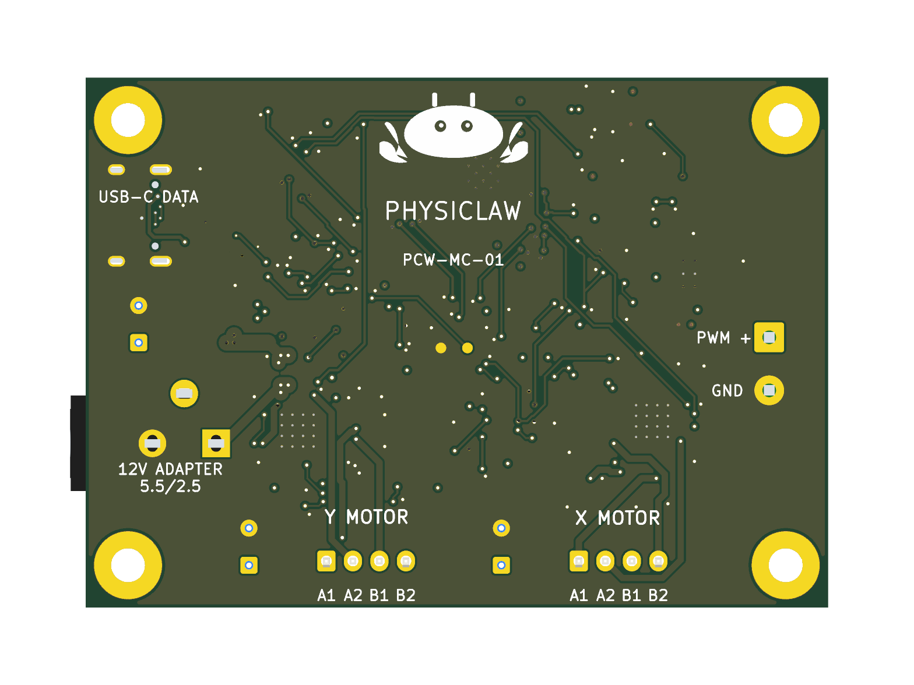

# PCW-MC-01 v1.0 reference files

- [Nine-sheet schematic PDF](schematic.pdf)
- [Bill of materials for all 99 fitted reference designators](bom.csv)
- [Editable KiCad project](../../pcb/kicad/PCW-MC-01.kicad_pro)

Run `make build` to regenerate the exports for your checkout. The build
records source and generated-file checksums in `build/manifest.json`.
[Build instructions](../../README.md#generate-the-manufacturing-files)

*Component side with both motor connectors along the front edge. Some package
models use simplified geometry.*

*Solder side with the board ID and bootloader recovery pads TP1 (IO0) and
TP2 (GND) near the centre.*
